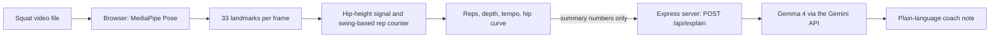

# HiperMove: AI Squat Analysis and Coaching


**HiperMove turns an ordinary squat video into reps, depth, tempo and a plain-language coaching note. No wearables, no special equipment, just a video.**

Upload a short squat clip and press play. HiperMove tracks your body in the browser, draws a live skeleton, counts your repetitions, measures how deep each squat goes and how long it takes, and plots your hip motion. When the video ends, Gemma 4 turns the numbers into a short, friendly explanation with one practical tip.

Built for **Hacktoberfest Hack Day, KodeKurrent Season 2** (Jais x Open Science Labs) for the problem statement **HiperMove: AI Movement & Mobility Assistant**.

## Links

| | |
|---|---|
| Demo video | [Watch on Google Drive](https://drive.google.com/file/d/1BgMzJc0LMuEciAqRWudeyNKN1TYC-fdB/view?usp=sharing) |
| Project presentation | [View the PPTX](https://docs.google.com/presentation/d/1LBDYwEeAw_N6Q-csoM-9Nvg9sQ5rpL5P/edit?usp=sharing&ouid=103074702273800134949&rtpof=true&sd=true) |
| Source code | This repository |
| Live website | Not deployed. Run it locally ([Getting started](#getting-started)), preview it with [`public/index.html`](#option-b-quick-preview-open-publicindexhtml-directly), or watch the demo video. |

## Contents

- [The problem](#the-problem)
- [What it does](#what-it-does)
- [Screenshots](#screenshots)
- [How it works](#how-it-works)
- [Tech stack](#tech-stack)
- [Project structure](#project-structure)
- [Getting started](#getting-started)
- [Using the app](#using-the-app)
- [Configuration](#configuration)
- [Deploy your own copy](#deploy-your-own-copy)
- [Hackathon requirements checklist](#hackathon-requirements-checklist)
- [Safety and privacy](#safety-and-privacy)
- [Testing status](#testing-status)
- [Limitations](#limitations)
- [Troubleshooting](#troubleshooting)
- [Future improvements](#future-improvements)
- [Credits and acknowledgements](#credits-and-acknowledgements)
- [Team](#team)
- [License](#license)

## The problem

The hackathon asked: *how can a smartphone help people understand and track their exercise movements without requiring additional equipment?*

Most people have no way to know whether they are squatting deeply, how steady their rhythm is, or how many clean reps they really did. HiperMove answers this with computer vision for the measurements and a language model for the explanation, using nothing but a video.

## What it does

- **Pose tracking in the browser.** MediaPipe Pose finds 33 body landmarks on every frame and draws a skeleton over your video.
- **Repetition counting.** Reps are detected from the movement of your hips, so it works from a front view or a side view.
- **Depth and tempo.** Every rep gets a depth percentage, a duration and a timestamp. The summary shows total reps, deepest depth, average time per rep and video length.
- **Live feedback during playback.** A depth rail, a hip-height line on the video and a large rep counter update in real time.
- **Hip-motion curve and rep log.** A graph of your hip height over time shows each squat as a dip, next to a log listing every rep.
- **Adjustable sensitivity.** A slider sets how large a movement must be to count as a rep.
- **Replay.** Re-run the analysis on the same video without uploading it again.
- **AI coach note.** One click sends a small summary of the results to Gemma 4, which writes a short explanation and one improvement tip.
- **Private by design.** The video is analysed on your device and is never uploaded.

## Screenshots

**Landing page** with a live animated demo of the tracking


**Live analysis** with skeleton overlay, hip line, depth rail and rep counter


**Hip-motion curve and rep log** showing six detected reps


**How it works** in three steps


**Coach's note** powered by Gemma 4


## How it works



### 1. See: pose tracking

MediaPipe Pose Landmarker runs inside the browser using WebAssembly. For each video frame it returns 33 body landmarks. HiperMove draws them as a skeleton on top of the video. Because this happens on your device, the video never leaves it.

### 2. Measure: counting reps, depth and tempo

HiperMove uses three landmark pairs: shoulders, hips and ankles. For every frame it computes one number:

```
hip height ratio = (ankle y - hip y) / (ankle y - shoulder y)
```

This is the height of the hips above the ankles divided by the body height. Dividing by body height cancels out how far the person stands from the camera, so the same logic works from the front or the side and at different distances.

The ratio is smoothed to remove jitter. Standing gives a high value, and squatting lowers it. From this signal:

- **Repetitions.** A rep is counted when the signal drops by at least the sensitivity value and then rises again by at least the same amount. This "swing-based" method needs no fixed standing height, so back-to-back squats are counted separately. The default sensitivity is `0.050`.
- **Depth.** How far the hips fell compared with the tallest standing position seen so far, shown as a percentage.
- **Tempo.** The time between consecutive reps, averaged over the session.
- **Visibility check.** Frames where the shoulders, hips or ankles are not clearly visible are skipped, and the interface asks the user to step into frame.

### 3. Explain: the AI coach

When the video finishes, the page sends a small JSON summary (repetitions, deepest depth, average time per rep and video length) to the Express server. The server reads your API key from the environment, asks Gemma 4 through the Gemini API to write a short plain-language note of at most about 90 words, and returns the text. The prompt tells the model to use only the supplied numbers, to avoid diagnosis or medical advice, and to say that the values are approximate.

## Tech stack

| Layer | Technology |
|---|---|
| Frontend | HTML, CSS, vanilla JavaScript, HTML5 Canvas |
| Pose tracking | [MediaPipe Pose Landmarker](https://ai.google.dev/edge/mediapipe/solutions/vision/pose_landmarker) (in the browser) |
| Backend | Node.js 18+, Express, dotenv |
| AI coaching | Gemma 4 through the Google Gemini API |

## Project structure

```
.
├── public/
│   └── index.html        The whole frontend: UI, pose tracking, rep counting, charts
├── server.js             Express server: serves public/ and exposes POST /api/explain
├── package.json          Dependencies and the npm start script
├── LICENSE               MIT license
└── .gitignore            Keeps .env and node_modules out of git
```

## Getting started

There are two ways to open the website.

### Option A: full app with the AI coach (recommended)

**Prerequisites**

- [Node.js](https://nodejs.org/) 18 or newer
- A Gemini API key from [Google AI Studio](https://aistudio.google.com/)
- An internet connection (the pose model and the AI coach are loaded online)

**1. Clone the repository**

```bash
git clone https://github.com/Ansum-1911/KodeKurrent-Season-2-Secondary-PS-hipermove.git
cd KodeKurrent-Season-2-Secondary-PS-hipermove
```

**2. Install dependencies**

```bash
npm install
```

**3. Add your API key**

Create a file named `.env` in the project root:

```
GEMINI_API_KEY=your_api_key_here
PORT=3000
```

`.env` is listed in `.gitignore`, so your key is never committed. Never paste the key into the code or share it.

**4. Start the server**

```bash
npm start
```

**5. Open the website**

Go to **http://localhost:3000** in Chrome, Edge or another modern browser.

### Option B: quick preview, open `public/index.html` directly

The entire frontend is one file. To try the video analysis without installing anything:

1. Download or clone the repository.
2. Open the `public` folder and double-click **`index.html`** (or drag it into a browser window).
3. Upload a squat video and press play.

In this mode the pose tracking, skeleton, rep counter, depth rail and charts work, because they run entirely in your browser. The **AI coach note will not work**, because it needs the Express server and an API key. Use Option A for that. An internet connection is still needed to load the pose model.

## Using the app

1. Click **Upload video** and choose a squat clip (a front or side view works).
2. Press **play** on the video. The skeleton and the live depth rail start moving, and the rep counter increases as each squat is detected.
3. Let the video play to the end. The hip-motion curve and the rep log fill in, and the summary shows reps, deepest depth, average time per rep and duration.
4. Click **Ask Gemma 4** to get your coach note.
5. Use **Replay** to run the analysis again. If reps are missed or extra reps appear, adjust the **Sensitivity** slider and replay.

**Tips for good results**

- Record the whole body from head to feet, with one person in frame.
- Keep the camera still and the lighting good.
- Use a clip of about 10 to 30 seconds.
- Lower the sensitivity value to catch smaller reps. Raise it if extra reps appear.

## Configuration

| Variable | Required | Description |
|---|---|---|
| `GEMINI_API_KEY` | Yes, for the AI coach | Your Google AI Studio / Gemini API key |
| `PORT` | No | Port the server listens on. The example above uses `3000`. |

The server exposes one API route:

| Route | Method | Purpose |
|---|---|---|
| `/api/explain` | POST | Receives the session summary as JSON and returns the Gemma 4 coaching note |

## Deploy your own copy

The app is a standard Node.js web service, so any Node host works. On [Render](https://render.com/) a free instance is enough:

1. Create a **New Web Service** and connect your fork of this repository.
2. Runtime: **Node**. Build command: `npm install`. Start command: `npm start`.
3. Instance type: **Free**.
4. Add the environment variable `GEMINI_API_KEY`. Do not set `PORT`, because the host provides it.
5. Deploy and open the URL it gives you.

Use a dedicated API key for a public deployment and set a usage limit in Google AI Studio, because anyone who finds the URL can trigger requests with your quota. Free instances on Render sleep when idle, so the first load can take about a minute.

## Hackathon requirements checklist

| Requirement from the problem statement | Status | How |
|---|---|---|
| Analyse a short exercise video | Done | Upload a squat video; analysis runs during playback |
| Display body-pose landmarks | Done | MediaPipe skeleton overlay on the video |
| Count repetitions | Done | Swing-based counter on the hip-height signal |
| Measure approximate movement patterns | Done | Depth, tempo, hip-motion curve, per-rep log |
| Present results in a simple interface | Done | Single-page interface with live depth rail and summary |
| Gemma 4 explains the results in plain language | Done | Coach note generated through the Gemini API |
| Use a pose-estimation tool for the measurements | Done | MediaPipe does all measurements; Gemma only explains them |
| Deploy for evaluators | Not done | Runs locally; see [Deploy your own copy](#deploy-your-own-copy) |

## Safety and privacy

- **Not medical advice.** HiperMove gives general fitness information only. It does not diagnose anything. Stop if anything hurts and ask a qualified professional.
- **Your video stays on your device.** Pose tracking runs in the browser. Nothing is uploaded to the server.
- **Only summary numbers leave the browser.** The coach note request contains a handful of numbers (reps, depth, tempo, duration) and no images or video. Google's terms for the Gemini API apply to that request.
- **Your API key stays on the server.** It is read from `.env` and is never sent to the browser or committed to git.

## Testing status

HiperMove was tested manually on a small number of squat clips, mainly one clip containing 7 squats. On that clip the app counted **6** of 7, because the first rep was not clearly visible. There are no automated tests yet, and the app has not been evaluated on a large or varied dataset. Treat the results as approximate.

## Limitations

- **Squats only.** The counting logic is designed around squats.
- **Uploaded videos only.** There is no live webcam mode yet.
- **Approximate results.** Counts, depth and tempo are camera-based estimates that depend on the angle and quality of the video.
- **Needs a clear view.** Hidden legs, very low light, strong motion blur or several people in frame reduce accuracy.
- **Needs internet.** The pose model is loaded from a CDN, and the coach note needs the Gemini API.
- **Coach note speed.** The AI response can take several seconds.
- **Not deployed.** The project currently runs locally.

## Troubleshooting

| Problem | Fix |
|---|---|
| Coach note shows `Unexpected token '<'` or `Cannot POST /api/explain` | You opened the page from the wrong place (for example a VS Code Live Server). Run `npm start` and open the address the server prints. |
| Coach note says the API key is missing | Create the `.env` file in the project root with `GEMINI_API_KEY=...`, then restart the server. |
| Ask Gemma 4 button is disabled | It enables after the video has played to the end. |
| Pose model fails to load | Check your internet connection and refresh the page. |
| Too few reps counted | Lower the sensitivity slider and replay. Make sure the whole body is visible. |
| Too many reps counted | Raise the sensitivity slider and replay. |
| Page changes do not appear | Hard refresh with `Ctrl + F5`. |
| `npm` is blocked in Windows PowerShell | Use `npm.cmd install` and `npm.cmd start` instead. |
| `EADDRINUSE` (port already in use) | Stop the other server, or set a different `PORT` in `.env`. |

## Future improvements

- Support more exercises such as push-ups, lunges and deadlifts
- Live webcam analysis
- Form checks such as knee and back angles
- Saved session history and progress charts
- Free public deployment with rate limiting on the AI route
- Automated tests for the rep-counting logic

## Credits and acknowledgements

- [MediaPipe](https://ai.google.dev/edge/mediapipe) by Google for pose estimation
- [Gemma 4](https://ai.google.dev/gemma) and the [Gemini API](https://ai.google.dev/gemini-api) by Google for the coaching notes
- [Express](https://expressjs.com/) and [dotenv](https://github.com/motdotla/dotenv)
- This project was built with AI assistance (Claude Code and Google AI Studio). The team chose the approach, tested the result and is responsible for the final submission.

## Team

**Team CampusSignal**, Rajiv Gandhi Institute of Petroleum Technology (RGIPT)

- Harshad Nandanwar (team leader)
- Ansum Sanal
- Aman Dusad
- Srithan Somayajula

Built for Hacktoberfest Hack Day, KodeKurrent Season 2, organised by IEEE RGIPT with Open Science Labs.

## License

Released under the [MIT License](LICENSE).
